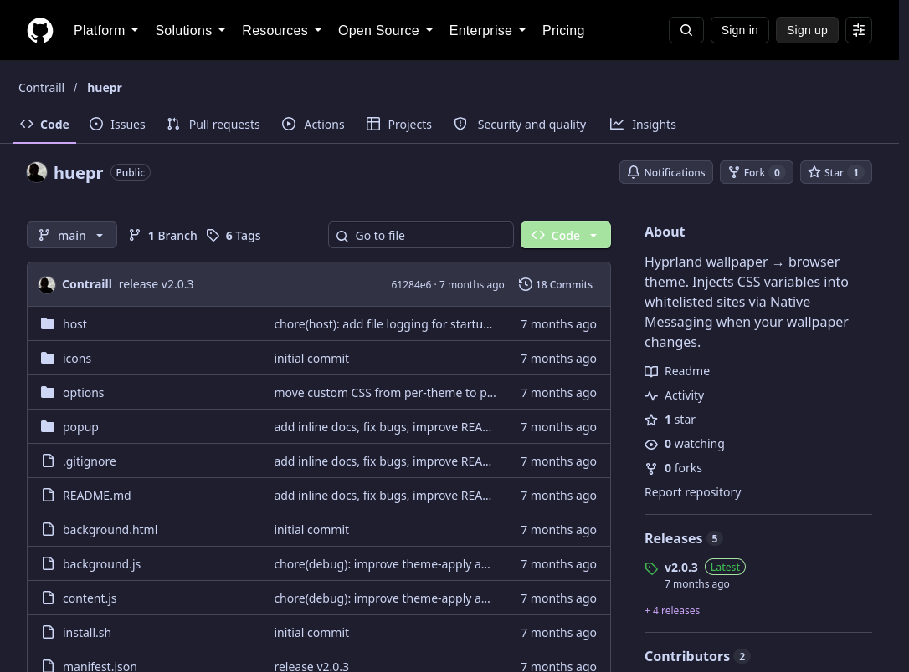
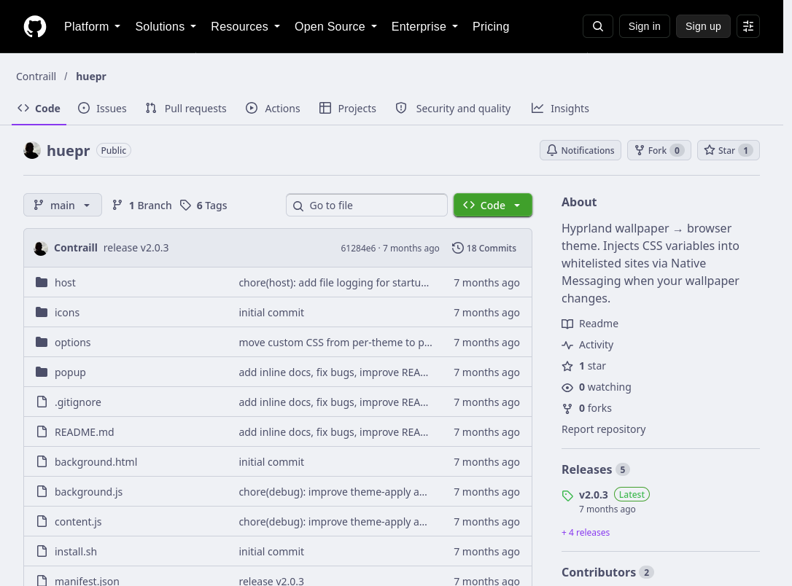
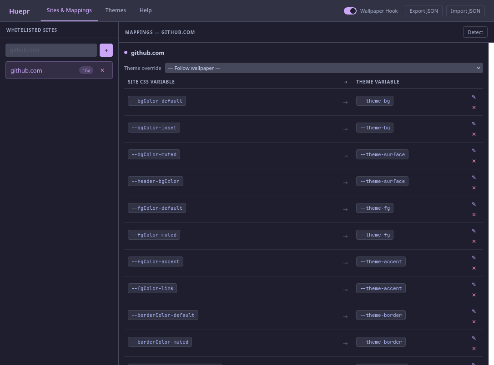
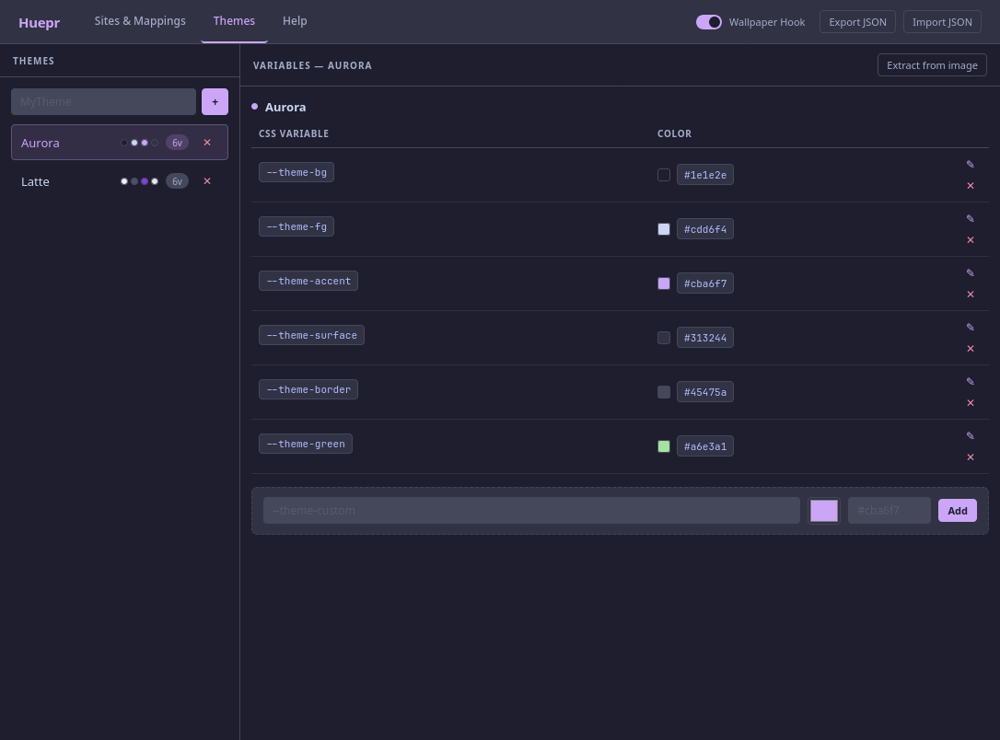
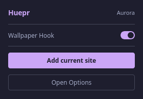
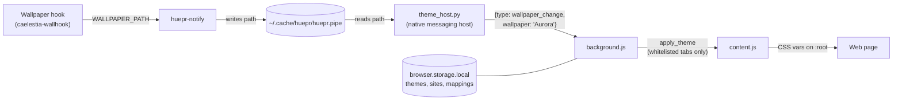

# Huepr

Wallpaper changes → browser theme. Huepr listens for wallpaper events via Native Messaging and injects CSS custom properties into whitelisted sites in real time.

Built for [Zen Browser](https://zen-browser.app) and Firefox on Hyprland + [Caelestia](https://github.com/caelestia-dots/caelestia). Any other wallpaper tool can trigger it by calling `huepr-notify`.

---

## Screenshots

The same GitHub page after two wallpaper changes, with no reload in between:

| Wallpaper `Aurora.jpg` | Wallpaper `Latte.png` |
| :---: | :---: |
|  |  |

| Sites & Mappings | Themes | Popup |
| :---: | :---: | :---: |
|  |  |  |

---

## How it works



1. Your wallpaper hook calls `huepr-notify` with the new wallpaper path.
2. The browser starts `theme_host.py` when the extension loads and keeps it running. The host reads the path from the named pipe, takes the filename stem (`/path/to/Aurora.jpg` → `Aurora`) and sends it to the extension over Native Messaging. Theme colors are not resolved in the host.
3. `background.js` matches the name against your themes and sends the resolved variables to every whitelisted tab.
4. `content.js` sets the variables on `:root`. Sites that use those variables update instantly.

---

## Features

- **Wallpaper-driven theming** — theme switches automatically when your wallpaper changes
- **Per-site CSS variable mapping** — map site variables (e.g. `--background`) to theme variables (e.g. `--theme-bg`)
- **Per-site theme override** — pin a specific theme to a site regardless of wallpaper
- **Custom CSS injection** — inject arbitrary CSS rules per site (override hardcoded colors, SVG fills, etc.)
- **Auto-detect site variables** — scan the active tab's stylesheets and pick variables to map
- **Color extraction from image** — extract a palette from any image to seed a new theme
- **Hook toggle** — disable wallpaper trigger and pick a theme manually
- **Smooth transitions** — CSS transition injected on theme change, removed after 600ms
- **Popup** — quick access to hook toggle, manual theme select, and "Add current site"
- **Updates** — the signed extension updates through the browser; `huepr-update` refreshes the host scripts, with an opt-in weekly timer

---

## Installation

```bash
git clone https://github.com/Contraill/huepr
cd huepr
bash install.sh
```

The installer downloads the latest **signed** XPI from [GitHub releases](https://github.com/Contraill/huepr/releases/latest) and places it in each Firefox / Zen profile it finds. Restart your browser and approve Huepr when it asks about the new add-on (or enable it in `about:addons`).

If no profile is found, install it by hand: `about:addons` → ⚙ → **Install Add-on From File** → `~/.local/share/huepr/huepr.xpi`.

> After installation the git directory can be deleted — everything Huepr needs is copied to `~/.local/`.

### Options

| Flag | Effect |
| --- | --- |
| `--auto-update` | Installs and enables a weekly systemd user timer that runs `huepr-update`. Off by default, because it runs `install.sh` from the git remote unattended. |
| `--dev` | For working on the extension: copies the unpacked source to `~/.local/share/huepr/extension` instead of installing the signed XPI. Load it through `about:debugging` → **Load Temporary Add-on**. Browser settings are not changed. |

### Requirements

- Firefox or Zen Browser (see [Compatibility](#compatibility))
- Python 3.8+
- curl (downloads the signed XPI)
- git (used by `huepr-update` to fetch updates)
- [Caelestia](https://github.com/caelestia-dots/caelestia) with `caelestia-wallhook` for the automatic wallpaper trigger — or add the `huepr-notify` line to your own hook

### Updating

The extension updates itself through the browser (`update_url` → [`updates.json`](updates.json)). To update the native host and helper scripts:

```bash
huepr-update
```

### Uninstalling

Close the browser, then:

```bash
huepr-uninstall        # or: bash uninstall.sh from the repo
```

It reverses every change listed below and keeps backups of the files it edits. Themes and site mappings live in the browser's extension storage; remove the add-on in `about:addons` to delete them too.

---

## What Huepr changes on your system

| Location | What | Removed by `huepr-uninstall` |
| --- | --- | --- |
| `~/.local/bin/huepr-theme-host` | Wrapper that starts the native host | ✓ |
| `~/.local/bin/huepr-notify` | Writes the wallpaper path to the pipe | ✓ |
| `~/.local/bin/huepr-update`, `huepr-uninstall` | Update / uninstall commands | ✓ |
| `~/.local/share/huepr/` | `theme_host.py`, cached signed XPI (unpacked source with `--dev`) | ✓ |
| `~/.mozilla/native-messaging-hosts/com.huepr.theme_host.json` | Native messaging manifest (also under `~/.zen/` if it exists) | ✓ |
| `~/.cache/huepr/` | Named pipe `huepr.pipe` and `host.log` | ✓ |
| `~/.config/huepr/config` | Git remote used by `huepr-update` | ✓ |
| `<profile>/extensions/huepr@localhost.xpi` | The signed extension, in each Firefox / Zen profile | ✓ |
| `caelestia-wallhook` | A comment and a `huepr-notify` line; backup saved as `caelestia-wallhook.huepr-bak` | ✓ (backup: `.huepr-uninstall-bak`) |
| `~/.config/systemd/user/huepr-update.{service,timer}` | Only with `--auto-update` | ✓ |

Browser preferences are **not** changed. Older versions of `install.sh` (up to the v2.0.3 release) added `user_pref("xpinstall.signatures.required", false);` to each profile's `user.js` and loaded the extension unpacked. Running the current `install.sh` or `huepr-uninstall` removes that line and the old proxy file (keeping `user.js.huepr-bak`). The value may already have been copied into `prefs.js`, so also reset `xpinstall.signatures.required` in `about:config`.

---

## Permissions

| Permission | Why |
| --- | --- |
| `nativeMessaging` | Receives wallpaper events from `theme_host.py`. The host only sends the wallpaper name; the extension never sends page data to it. |
| `storage` | Keeps themes, whitelisted sites, mappings and custom CSS in `browser.storage.local`. |
| `tabs` | Reads tab URLs to find whitelisted tabs, sends them theme updates and finds the active tab for **Add current site** and **Detect**. |
| Site access (optional) | Requested **per site** when you add it — `*://github.com/*` and `*://www.github.com/*` for `github.com`. Removing a site gives the access back. |

The manifest lists `<all_urls>` only under `optional_permissions`, as the upper bound of what can be requested. A new install starts with access to no website. `content.js` is registered at runtime for the granted sites only, and is injected into tabs that are already open when access is granted.

What the content script does on a granted site:

- On load it asks `background.js` for a theme and sets the CSS variables on `:root`. If you configured custom CSS, it also adds a `<style>` element.
- **Detect** reads CSS variable *names* from the page's stylesheets, and only when you press it.

Huepr makes no network requests and sends no page content anywhere.

**Upgrading from 2.0.x:** `<all_urls>` was a required permission before 2.1.0. The browser keeps it granted after the update, so your sites keep working. To switch to per-site access, turn off "Access your data for all websites" under `about:addons` → Huepr → Permissions. Then click **Grant** next to each site in Options → Sites & Mappings.

---

## Compatibility

- **Browsers:** Firefox 91+ (`strict_min_version` in the manifest) and Zen Browser. The installer finds profiles in `~/.mozilla/firefox`, `~/.config/mozilla/firefox`, `~/.zen` and `~/.config/zen`.
- **OS:** Linux only (named pipe, `~/.local` and `~/.mozilla` paths).
- **Extension format:** Manifest V2 WebExtension. Chromium-based browsers are not supported.

Known limits:

- Flatpak and Snap browser builds are sandboxed and cannot start a native host from `~/.local/bin`; the installer does not configure them.
- Release builds of Firefox only load signed add-ons. Use the signed XPI, or `--dev` with `about:debugging` while developing.
- Content scripts do not run on `about:` pages, `addons.mozilla.org` or other restricted pages, and site access can only be requested for `http`/`https` sites.
- Sites that do not use CSS variables need custom CSS rules. A site's own `!important` rules inside CSS cascade layers win over custom CSS rules, even when those are `!important`.
- **Detect** cannot read cross-origin stylesheets that block CORS.
- If the native host cannot be reached, the extension retries 10 times, 5 seconds apart. The last theme stays applied, and manual theme selection keeps working. Restart the browser to reconnect after that.

---

## Setup

### 1. Add a site

Open the popup (click the Huepr icon) → **Add current site**, or go to **Options → Sites & Mappings** and type a hostname. Allow access when the browser asks — Huepr only gets access to that site.

### 2. Create a theme

**Options → Themes** → type a name → **Add Theme**. The theme name must match your wallpaper filename stem for automatic switching (`Aurora.jpg` → theme `Aurora`).

Add variables to the theme — e.g. `--theme-bg: #1e1e2e`, `--theme-accent: #cba6f7`.

### 3. Map site variables to theme variables

In **Sites & Mappings**, select a site. Add a mapping:
- **Site variable** — the CSS variable the site uses (e.g. `--bgColor-default` on GitHub)
- **Theme variable** — the theme variable to pull the value from (e.g. `--theme-bg`)

Use **Detect** to scan the active tab's stylesheets and find variables automatically.

### 4. Optional: Custom CSS

In **Sites & Mappings**, select a site and add custom CSS rules to override hardcoded colors:

```css
/* Override YouTube logo red */
path[fill="#FF0033"] { fill: var(--theme-accent) !important; }
```

### Using another wallpaper tool

Call `huepr-notify` from whatever runs after a wallpaper change:

```bash
WALLPAPER_PATH="/path/to/Aurora.jpg" ~/.local/bin/huepr-notify
```

---

## Project structure

```
install.sh          — installer: NM host, helper scripts, signed XPI, wallpaper hook
uninstall.sh        — reverts everything install.sh did (installed as huepr-uninstall)
manifest.json       — WebExtension manifest (MV2)
background.js       — background page: NM connection, theme resolution, message routing
content.js          — content script: CSS variable + custom CSS injection
popup/              — browser action popup
options/            — options page (themes, sites & mappings, help)
host/
  theme_host.py     — native messaging host: reads pipe, sends theme to extension
icons/              — extension icons
screenshots/        — README images
updates.json        — update manifest for the signed XPI releases
web-ext-config.mjs  — keeps non-extension files out of the XPI (web-ext build / sign)
```

---

## How themes work

A theme is a flat key-value map of CSS custom properties:

```json
{
  "--theme-bg":      "#1e1e2e",
  "--theme-surface": "#313244",
  "--theme-accent":  "#cba6f7",
  "--theme-fg":      "#cdd6f4",
  "--theme-border":  "#45475a"
}
```

When active, all theme variables are injected into `:root` on whitelisted sites. Site mappings then alias site-specific variables to theme values:

```
--site-background  →  value of --theme-bg
--site-link-color  →  value of --theme-accent
```

Aurora, Sunset, Latte and Frappe ship as built-in presets; a theme with the same name in Options overrides their variables.

---

## Troubleshooting

**Extension icon doesn't appear**
Check `about:addons` — sideloaded add-ons stay disabled until you approve them. `about:debugging` → This Firefox lists every loaded extension.

**Theme doesn't switch on wallpaper change**
- Verify the hook is patched: `grep huepr-notify ~/.local/bin/caelestia-wallhook`
- Check `~/.cache/huepr/host.log` — every received wallpaper event is logged there
- `about:debugging` → Huepr → Inspect → check the background console for connection messages

**CSS variables not applying**
Open Options → Sites & Mappings → confirm the site is whitelisted and has mappings. A **Grant** button next to a site means Huepr has no access to it yet. Use the **Detect** button to find available CSS variables on the active tab.

**`huepr-update` fails**
Check that `~/.config/huepr/config` contains a valid `REPO_URL` pointing to a git remote.

---

## License

[MIT](LICENSE)
